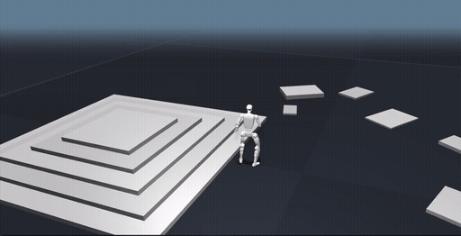
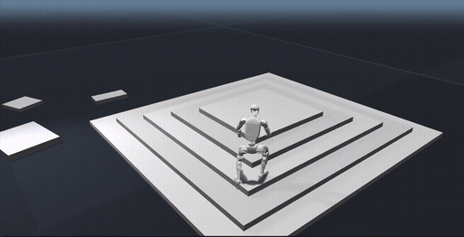

# PMT — Perceptive Motion Tracking

**Project page:** https://acodedog.github.io/perceptive-bfm/

<table>
  <tr>
    <td align="center"><br><sub><b>Cartwheel</b></sub></td>
    <td align="center"><br><sub><b>Backflip</b></sub></td>
  </tr>
</table>

PMT trains humanoid **motion-tracking** RL policies for the Unitree G1 on
[Isaac Lab](https://isaac-sim.github.io/IsaacLab/): DeepMimic-style imitation, vision/terrain
perception, cross-embodiment (SONIC), adversarial imitation (ADD), and
**teacher → distill → finetune** pipelines. Everything is **config-driven**: a task *selects*
independent axes (`robot` / `terrain` / `motion` / `obs` / `reward` / `network` / `algorithm` /
`stage`) and the builder *derives* the coupled ones, failing loud on invalid combos.

**What's in this repo**

- **Training & playback** — `scripts/train.py` / `scripts/play.py` over a catalog of ~25 G1 tasks
  ([Task catalog](#task-catalog)), config-composed from `configs/` by the
  [`pmt_tasks/`](pmt_tasks/README.md) task layer.
- **Pretrained policies** — ready-to-run G1 checkpoints under `checkpoints/pretrained/`.
- **Demo motion data** — a 99-pair sample of `raw`/`optimized` terrain clips + terrain meshes
  under `assets/` so the terrain/distill tasks run out-of-the-box.
- **TCRS** — an MPPI terrain-motion optimizer ([`TCRS/`](TCRS/README.md)) that generates the
  `optimized` clips from `raw` motion + a terrain scene.
- **MuJoCo backend** — the flat task family also runs on [mjlab](https://github.com/mujocolab/mjlab)
  (MuJoCo-Warp); see [`docs/MJLAB_USAGE.md`](docs/MJLAB_USAGE.md).

> **Scope:** this is a research/training codebase. It runs **inside** an existing Isaac Lab install
> (it does not vendor Isaac Sim / Isaac Lab) — see [Install](#install).

**PMT/PGMT version record:** [`pgmt-p4-2026.10.19`](CHANGELOG.md) records collection
optimizations, shared actor/critic encoding, batched PPO logging, multi-GPU training,
central 2×2 spawn patches, timeout boundary handling, and policy playback tools.
T1 now rewards continuous support quality only when both feet match the reference
support pattern. The earlier 8,192-environment `train_01` completed 20,000 updates
with the old event-based T1; `train_02` uses the new rule and was still running at
the recorded snapshot. These checkpoints have different strict-resume contracts.
Recovery and complete policy/convergence evaluation remain pending. See the
[local usage guide](docs/USER_READ.md) and [version snapshot](docs/versions/pgmt-p4-2026.10.19.json).

---

## Install

For the isolated RTX 5090 server environment, reproducible smoke tests, MP4
recording, and the `projects/tutorial` VNC workflow, see
[`docs/SERVER_SETUP.md`](docs/SERVER_SETUP.md).
The completed server validation, training curves, and videos are indexed in
[`docs/SMOKE_REPORT_2026-09-23.md`](docs/SMOKE_REPORT_2026-09-23.md).

PMT runs **inside an Isaac Lab Python environment** — it does not vendor Isaac Sim / Isaac Lab. Get a
working Isaac Lab install first, then install PMT (editable) into that env:

```bash
conda activate <isaac-lab-env>           # the env that has Isaac Lab + Isaac Sim
export OMNI_KIT_ACCEPT_EULA=YES          # accept the Omniverse EULA for headless launches
cd /path/to/PMT
python scripts/download_robot_assets.py  # installs the required Unitree G1 URDF + meshes
python -m pip install -e .               # installs the motion_tracking_rl RL core
```

Run all commands from the repository root (`pmt_tasks/`, `configs/`, `scripts/` are used in place).

**Prerequisites:** an importable `isaaclab` / `isaaclab_tasks`, Python ≥ 3.10, and per-task motion
`*.npz` clips. The command above downloads the Unitree G1 robot descriptions into
`pmt_tasks/assets/`, where PMT discovers them automatically. To use an existing copy instead, set
`PMT_ASSET_DIR` to the directory that contains `unitree_description/`.

**Paths.** PMT never hard-codes machine paths: `configs/paths.yaml` carries profile-selected roots
and each reads a `PMT_*` env override. The key ones:

| Variable | Points to |
| --- | --- |
| `PMT_PROFILE` | Selects the `paths.yaml` block (`local` \| `cluster`, default `local`). |
| `PMT_DATA_ROOT` | Meshes/terrain assets and (default) logs. |
| `PMT_MOTION_ROOT` | Standalone flat motion clips. |
| `PMT_DATASET_ROOT` | Parent of the `terrain/` + `sonic/` clip trees. |

The full env-var table (including per-task overrides) lives in [`docs/USAGE.md`](docs/USAGE.md).

---

## Download assets

### Required robot assets

PMT uses the Unitree robot-description archive linked by the official
[BeyondMimic](https://github.com/HybridRobotics/whole_body_tracking) setup instructions. The
archive is not stored in this repository. Install its G1 URDF and meshes with:

```bash
python scripts/download_robot_assets.py
```

The download is approximately 56 MB and expands to approximately 181 MB. The downloader installs
into `pmt_tasks/assets/` by default, pins the upstream archive's SHA-256 checksum, rejects unsafe
archive entries, and extracts through a temporary directory so an interrupted download does not
leave a partial installation. For a shared location, use
`python scripts/download_robot_assets.py --asset-dir /path/to/assets` and then export
`PMT_ASSET_DIR=/path/to/assets`. For offline installation, download the same archive separately and
pass `--archive /path/to/unitree_description.tar.gz`; its checksum is still verified.

### Demo motions and pretrained policies

The pretrained checkpoints and demo motion clips are stored in this GitHub repo as Git LFS objects,
but the recommended download path is the Hugging Face mirror. It includes the repo-relative asset
files under `assets/`, `checkpoints/`, and `TCRS/`, plus `SHA256SUMS.txt`.

**Recommended: Hugging Face**

```bash
# From anywhere. Install the CLI first if `hf` is not available:
# python -m pip install -U "huggingface_hub[cli]"
hf download aCodeDog/PMT-assets --repo-type dataset --local-dir /tmp/PMT-assets

# Verify the staged download before copying it into the PMT checkout.
cd /tmp/PMT-assets
shasum -a 256 -c SHA256SUMS.txt

# Copy the asset trees into your PMT repository root.
cd /path/to/PMT
rsync -a /tmp/PMT-assets/assets /tmp/PMT-assets/checkpoints /tmp/PMT-assets/TCRS ./
```

Use a staging directory first because the Hugging Face dataset has its own `README.md`; the `rsync`
command above copies only the folders PMT needs.

**Mirror: Google Drive**

If Hugging Face is unavailable, download the Drive mirror and copy the same top-level folders into
the PMT repository root:

https://drive.google.com/drive/folders/1eKKCBihsATkp5uVu1MYNejaWchv2hxR3?usp=sharing

```bash
cd /path/to/PMT
rsync -a /path/to/downloaded/PMT_Assets/assets \
  /path/to/downloaded/PMT_Assets/checkpoints \
  /path/to/downloaded/PMT_Assets/TCRS ./
```

**Fallback: Git LFS**

If GitHub LFS bandwidth is available, the original LFS objects can still be fetched directly:

```bash
git lfs install          # once
git lfs pull
```

---

## Quickstart

Train the standard flat multi-motion G1 task:

```bash
python scripts/train.py --task PMT-G1-MultiMotionV2-Flat-v0 \
  --num_envs <n> --headless --max_iterations <iters>
```

Checkpoints land under `logs/rsl_rl/<experiment_name>/<run_name>/model_<iteration>.pt`. Play a
trained checkpoint on a motion file or directory:

```bash
python scripts/play.py --task PMT-G1-MultiMotionV2-Flat-v0 \
  --num_envs 1 --resume_path <checkpoint.pt> \
  --motion_file <motion-file-or-dir> --headless --max_steps 300
```

`scripts/train.py` dispatches the runner class from the derived `runner` axis — distillation tasks
route to `DistillationRunner`, on-policy tasks to `OnPolicyRunner`, same entrypoint. Common flags:
`--num_envs`, `--max_iterations`, `--seed`, `--profile local|cluster`, `--resume` /
`--resume_path <ckpt.pt>`, `--headless`.

---

## Run on MuJoCo (mjlab backend)

PMT also runs on **[mjlab](https://github.com/mujocolab/mjlab)** (a MuJoCo-Warp reimplementation of
Isaac Lab's manager-based API) — convert a clip, then eval or view a trained checkpoint in mjlab.
The flat task family is wired today; terrain/vision/distill stay Isaac-Lab-only for now, and
checkpoints need a short mjlab fine-tune for exact transfer.

**👉 See [`docs/MJLAB_USAGE.md`](docs/MJLAB_USAGE.md) for the full how-to** (install, clip
conversion, the eval/view commands, supported tasks, and backend selection).

---

## Pretrained models

Ready-to-use G1 policies are expected under [`checkpoints/pretrained/`](checkpoints/pretrained/).
Use [Download assets](#download-assets) to populate the mirrored checkpoints after cloning.

| File | Task / gym id | Network | reward |
| --- | --- | --- | --- |
| `multimotionv2_flat.pt` | `PMT-G1-MultiMotionV2-Flat-v0` | ActorCritic (MLP) | 40.9 |
| `multimotionv2_streaming_flat.pt` | `PMT-G1-MultiMotionV2-Streaming-Flat-v0` | ActorCritic (MLP) | 39.5 |
| `multimotionv2_adaptive_flat.pt` | `PMT-G1-MultiMotionV2-Adaptive-Flat-v0` | ActorCritic (MLP) | 46.4 |
| `multimotionv2_uniform_flat.pt` | `PMT-G1-MultiMotionV2-Uniform-Flat-v0` | ActorCritic (MLP) | 46.4 |
| `bpo_multimotionv2_flat.pt` | `PMT-G1-BPO-MultiMotionV2-Flat-v0` | ActorCritic (MLP) | 33.7 |
| `fpo_plus_singleclip_flat.pt` | `PMT-G1-FPOPlus-SingleClip-Flat-v0` | DiffusionActorCritic | 39.9 |
| `add_multimotion_flat.pt` | `PMT-ADD-MultiMotionV2-Flat-v0` | ActorCritic + discriminator | 18.0¹ |
| `rgmt_flat.pt` | `RGMT-G1-v0` | TransformerActorCritic | 33.5 |
| `perceptive_motion_token_tracker.pt` | `PMT-PerceptiveMotionTokenTracker-G1-v0` | PerceptiveMotionTokenTracker | 80.9 |
| `pcrbt_100style.pt` | `PMT-PCaRBT-100style-G1-v0` | PerceptiveResidualBehaviorTokenTracker | 62.4 |
| `walkdance_bigmap_teacher.pt` | `PMT-WalkDanceBigMap-G1-v0` | TransformerActorCritic | 86.6 |
| `distill_bigmap_walkdance.pt` | `PMT-Distill-SteppingStone-LatentAnchor-G1-v0` | VisionStudentTeacher | — |
| `ppoft_vision_bigmap_walkdance.pt` | `PMT-PPOFinetune-VisionTeacher-SteppingStone-G1-v0` | VisionTransformerActorCritic | 71.9 |
| `sonic_onnx/` | `PMT-SONIC-G1-MultiMotionV2-Flat-v0` | SONIC (official ONNX) | — |

¹ ADD's `Train/mean_reward` is intentionally small (adversarial imitation); the run is full-length and healthy.
`reward` = max `Train/mean_reward`.

```bash
python scripts/play.py --task PMT-G1-MultiMotionV2-Flat-v0 \
  --resume_path checkpoints/pretrained/multimotionv2_flat.pt --num_envs 16
```

See [`checkpoints/pretrained/README.md`](checkpoints/pretrained/README.md) for provenance and
per-checkpoint task/data requirements.

---

## Demo motion data

A 99-pair sample of terrain-anchored G1 clips ships under
[`assets/motions/`](assets/motions/README.md) so the terrain / distill tasks run out-of-the-box:
`terrain_mocaphouse/walk_dance1sub2start/{raw,optimized}/`.

**What the clips are.** Each is a `.npz` of a 50 fps, 29-DoF G1 trajectory (world-frame body
poses + joint angles/velocities — full schema in
[`docs/MOTION_DATA_FORMAT.md`](docs/MOTION_DATA_FORMAT.md)). They come in 99 matched
`raw`↔`optimized` pairs (paired by filename stem):

- **`raw/`** — the flat-retargeted source motion (the vision student's reference).
- **`optimized/`** — the **terrain-adapted** version of that same motion, with the feet
  re-placed onto the terrain (the teacher's reference).

**Where the terrain comes from.** The `optimized/` clips are produced by **[TCRS](TCRS/README.md)**
(this repo's MPPI terrain-motion optimizer): it takes a `raw` clip + a terrain scene and re-places
the feet onto it. These demo clips were optimized onto the **`big_map` mesh** shipped under
[`assets/terrain/g1_29dof_big_map.stl`](assets/terrain/) — the same mesh the
`PMT-WalkDanceBigMap-G1-v0` task tracks them on. Point PMT at it:

```bash
# First populate assets/checkpoints with Download assets.
export PMT_TERRAIN_MOTION_ROOT=$(pwd)/assets/motions  # demo clips (from the repo root)
export PMT_TERRAIN_ASSET_DIR=$(pwd)/assets/terrain    # big_map .stl mesh (shipped under assets/terrain/)
python scripts/play.py --task PMT-WalkDanceBigMap-G1-v0 \
  --resume_path checkpoints/pretrained/walkdance_bigmap_teacher.pt --num_envs 4
```

See [`assets/motions/README.md`](assets/motions/README.md) for details. Bringing your own clips?
**[`docs/MOTION_DATA_FORMAT.md`](docs/MOTION_DATA_FORMAT.md)** is the `.npz` contract the motion
command expects — required keys, shapes, dtypes, and the Isaac-Lab body/joint order.

---

## TCRS — terrain motion generation

[TCRS](TCRS/README.md) is the terrain-adaptive motion optimizer (MPPI). It takes a **flat-ground
motion clip** plus a **terrain scene XML** and produces the **terrain-optimized** version of that
motion for the G1 — feet are re-placed onto stairs/stones via an MPPI swing planner + Jacobian IK,
and the pelvis height is re-targeted. PMT consumes the resulting `optimized/` clips as the teacher's
reference motions (the `raw/` clips feed the vision student).

```
 flat motion .npz  +  terrain scene .xml   ──TCRS──▶   raw/ + optimized/ + ghost/  *.npz
```

See [`TCRS/README.md`](TCRS/README.md) for the CLI and arguments.

---

## Task catalog

Train with `scripts/train.py --task <id> …`; play with `scripts/play.py --task <id> --resume_path
<ckpt.pt> --motion_file <npz-or-dir> …`. Full per-task command forms are in [`docs/USAGE.md`](docs/USAGE.md).

| Family | Gym ids |
| --- | --- |
| Motion-tracking PPO (flat MLP) | `PMT-G1-MultiMotionV2-Flat-v0` (+ `-Uniform-`, `-Adaptive-`, `-Streaming-`, `-100style-`, `-Streaming-100style-` variants) |
| Transformer / terrain | `PMT-SteppingStone-G1-v0`, `PMT-Backflip-G1-v0`, `PMT-TerrainFlatMix-G1-v0`, `PMT-WalkDanceBigMap-G1-v0`, `PMT-CartwheelBigMap-G1-v0` |
| Distillation / perceptive | `PMT-Distill-SteppingStone-G1-v0`, `PMT-Distill-SteppingStone-LatentAnchor-G1-v0`, `PMT-PerceptiveMotionTokenTracker-G1-v0`, `PMT-PCaRBT-G1-v0`, `PMT-PCaRBT-100style-G1-v0` |
| Other algorithms | `PMT-G1-BPO-MultiMotionV2-Flat-v0`, `PMT-ADD-MultiMotionV2-Flat-v0`, `PMT-G1-FPOPlus-SingleClip-Flat-v0`, `PMT-SONIC-G1-MultiMotionV2-Flat-v0`, `RGMT-G1-v0` |
| BFM-Zero (separate runner) | `BFM-Zero-Flat-MultiMotionV2-G1-v0` via `scripts/bfm_zero/train.py` |

See [`pmt_tasks/env_cfgs/README.md`](pmt_tasks/env_cfgs/README.md) for the per-family env cfgs.

---

## Repository layout

```
PMT/
├── configs/                # source of truth: axis-group YAMLs + one task composition per experiment
├── motion_tracking_rl/     # the RL core (algorithms, networks, runners, compat matrix)
├── pmt_tasks/              # task layer: builder, derive, registry_gym, mdp/, env_cfgs/, robots/
├── scripts/                # train.py, play.py, mjlab_*, ...
├── TCRS/                   # terrain-adaptive motion optimizer (MPPI) — generates optimized clips
├── assets/                 # demo motion clips, terrain meshes, and demo videos
├── checkpoints/pretrained/ # pretrained G1 policies
├── tests/                  # pure test suite + runtime gate scripts
└── docs/                   # USAGE.md, ARCHITECTURE.md, compat_matrix.md, MJLAB_USAGE.md, ...
```

`configs/` is the source of truth — see [`configs/README.md`](configs/README.md) for the
config-author guide, [`pmt_tasks/README.md`](pmt_tasks/README.md) for the task layer (how a task
yaml becomes a runnable gym env), and [`docs/ARCHITECTURE.md`](docs/ARCHITECTURE.md) for the design.

---

## Further reading

- [`docs/PGMT_STAGE1.zh-CN.md`](docs/PGMT_STAGE1.zh-CN.md) — PGMT stage 1 on the native PMT PPO/Isaac/G1 pipeline, LAFAN1 data preparation, short-training results and CPU MuJoCo evaluation.
- [`docs/USAGE.md`](docs/USAGE.md) — full env-var table, per-task command forms, the teacher →
  distill → finetune pipeline, SONIC ONNX, and how to add a task / motion / robot / network.
- [`docs/ARCHITECTURE.md`](docs/ARCHITECTURE.md) — axis taxonomy, derivation table, layering contract.
- [`docs/compat_matrix.md`](docs/compat_matrix.md) — generated algorithm × network compatibility matrix.
- [`docs/MJLAB_USAGE.md`](docs/MJLAB_USAGE.md) — **how to run PMT on the mjlab (MuJoCo-Warp) backend**: convert clips, eval/view a trained ckpt, select the backend.
- [`docs/MJLAB_BACKEND_PLAN.md`](docs/MJLAB_BACKEND_PLAN.md) — MuJoCo/mjlab backend port plan + status (design doc).
- [`docs/MOTION_DATA_FORMAT.md`](docs/MOTION_DATA_FORMAT.md) — the `.npz` motion-clip contract (keys, shapes, body/joint order) the motion command consumes.
- [`pmt_tasks/env_cfgs/README.md`](pmt_tasks/env_cfgs/README.md) — released task families + env cfgs.
- [`TCRS/README.md`](TCRS/README.md) — terrain-adaptive motion generation.
- [`checkpoints/pretrained/README.md`](checkpoints/pretrained/README.md) — pretrained model table + provenance.

---

## Acknowledgements

PMT builds on, ports, or reimplements a number of open works. We gratefully acknowledge them; if
you use the corresponding parts of PMT, please cite the original sources.

**Frameworks & infrastructure**

- **Isaac Lab** — the simulation/RL framework PMT runs on. https://github.com/isaac-sim/IsaacLab
- **rsl_rl** — the PPO / distillation runner core. https://github.com/leggedrobotics/rsl_rl
- **mjlab** — MuJoCo-Warp reimplementation of Isaac Lab's manager API (PMT's optional MuJoCo backend). https://github.com/mujocolab/mjlab
- **BeyondMimic / whole_body_tracking** — the motion-tracking task and reward stack PMT descends from. Repo: https://github.com/HybridRobotics/whole_body_tracking · Paper: https://arxiv.org/abs/2508.08241

**Methods reimplemented or integrated as PMT tasks**

- **SONIC** (cross-embodiment whole-body control) — Code: https://github.com/NVlabs/GR00T-WholeBodyControl · Paper: https://arxiv.org/abs/2511.07820
- **RGMT** — https://arxiv.org/abs/2601.23080
- **ADD** (adversarial motion imitation) — https://arxiv.org/html/2505.04961v1 · https://add-moo.github.io/
- **BPO** — https://arxiv.org/abs/2604.18578
- **FPO++** (flow-policy optimization) — Code: https://github.com/amazon-far/fpo-control · Paper: https://arxiv.org/abs/2602.02481
- **BFM-Zero** (FB-CPR behavior foundation model) — https://arxiv.org/abs/2511.04131

The bundled BFM-Zero (FB-CPR-Aux) code under `motion_tracking_rl/bfm_zero/_vendor/` is vendored from
its upstream release; see the License note below and [`THIRD_PARTY_LICENSES`](THIRD_PARTY_LICENSES).

---

## License

PMT's own code is released under the **BSD 3-Clause License** (see [`LICENSE`](LICENSE)). PMT also
vendors/derives from upstream projects under their own licenses — see
[`THIRD_PARTY_LICENSES`](THIRD_PARTY_LICENSES) for the full inventory. **Note:** the bundled BFM-Zero
(FB-CPR-Aux) code in `motion_tracking_rl/bfm_zero/_vendor/` is **CC BY-NC 4.0 (NonCommercial)**, so
the repository as distributed is for **non-commercial / research use** unless those paths are removed.
